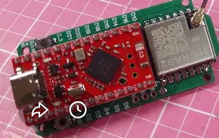
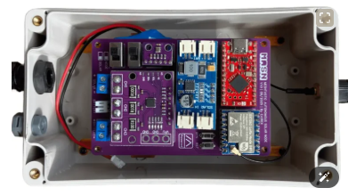

# Configurador Meshtastic Canarias (FAKETEC y MASN)

Programa de Windows para preparar módulos **FAKETEC** y **MASN** basados en **Nice!Nano /
Pro Micro (nRF52840)** con firmware **Meshtastic**: instala o actualiza el firmware, aplica una configuración completa
(`plantilla.yaml`) con el nombre de nodo que indiques, comprueba campo a campo que todo ha
quedado bien, guarda un backup y deja el nodo con el Bluetooth activo.

Realizado por **Eduardo, EA8II**. Software de **uso educativo** (ver descargo más abajo).

> [!WARNING]
> **Configuración para Canarias.** Los canales de la plantilla (canal principal LongFast +
> «Canarias» + «Emergencias») y la radio (región EU_868, modo LONG_FAST) son los
> predeterminados de la red Meshtastic de **Canarias**. En la Península u otras zonas los
> canales y el modo pueden ser distintos: consulta a tu comunidad local y ajusta
> `plantilla.yaml` antes de usar el programa.

## ¿Qué módulos sirven?

Módulos **FAKETEC** y **MASN**: los dos llevan una placa **Nice!Nano / Pro Micro nRF52840**
(la placa roja con USB-C) y un módulo de radio LoRa, y usan el firmware Meshtastic
«nRF52 Pro-micro DIY».

| FAKETEC | MASN |
|:---:|:---:|
|  |  |
| Pro Micro nRF52840 + módulo LoRa sobre la placa FAKETEC (verde). | Placa MASN (rotulada «MASN») con la Pro Micro nRF52840 y el LoRa, montada en caja estanca. |

## Descarga y uso

1. Descarga `ConfiguradorMeshtasticCanarias.zip` de la sección **Releases** y descomprímelo.
2. Cierra Meshtastic Web, la app de Meshtastic o cualquier programa que use el puerto USB.
3. Abre `ConfiguradorMeshtasticCanarias.exe` y acepta las condiciones.
4. Escribe el nombre del nodo y el nombre corto (máx. 4) y pulsa **Configurar nodo**.
5. Conecta la placa y sigue los avisos de la ventana.

Funciona en cualquier Windows 10/11 de 64 bits **sin instalar nada y sin Internet**: Python,
la librería meshtastic, el bootloader y el firmware van dentro del `.exe`. La primera vez,
Windows puede mostrar «Windows protegió su PC» porque el programa no está firmado
(*Más información → Ejecutar de todas formas*).

Más detalles en [`ConfiguradorMeshtasticCanarias/LEEME.txt`](ConfiguradorMeshtasticCanarias/LEEME.txt).

## Qué hace

- **Firmware**: con Internet usa siempre la última versión estable para «nRF52 Pro-micro DIY»
  (la misma lista que [flasher.meshtastic.org](https://flasher.meshtastic.org)); sin Internet,
  la incluida (2.7.26). Si la placa ya tiene Meshtastic, la pone sola en modo bootloader para
  actualizarla; si está nueva o sin firmware, pide pulsar RESET dos veces.
- **Bootloader**: comprueba que exista (UF2). Si es anterior a 0.9.2 ofrece actualizarlo.
  Una placa sin bootloader necesita un programador SWD (el programa lo explica).
- **Configuración**: aplica la plantilla completa y el nombre, verifica campo a campo y repite
  si algo no coincide.
- **Backup**: guarda una copia completa de cada nodo en `backups\` (incluye sus claves
  privadas: no la compartas).
- **Bluetooth**: el firmware lo apaga mientras hay una conexión USB de configuración, así que
  el programa reinicia el nodo al final para dejarlo activo.
- No configura placas sin bootloader + firmware Meshtastic, pide confirmación antes de
  reconfigurar un nodo que ya tiene nombre propio y avisa si el modelo no es FAKETEC / MASN.

## Estructura

```
ConfiguradorMeshtasticCanarias/   Lo que se distribuye junto al .exe (LEEME.txt, plantilla.yaml)
fuente/
  configurar_nodo.py      Núcleo: detección, bootloader, firmware, configuración, verificación
  interfaz.py             Ventana de Windows (tkinter)
  uf2/                    Bootloader y firmware incluidos (ver uf2/LICENCIAS.md)
herramientas/
  backup_completo_meshtastic.py   Backup completo (todos los campos) de un nodo por USB
compilar.ps1              Genera el .exe y el ZIP
```

## Compilar

Con Python 3.12 (x64) instalado:

```powershell
powershell -ExecutionPolicy Bypass -File compilar.ps1
```

También se puede ejecutar sin compilar (requiere `pip install meshtastic==2.7.11`):

```powershell
python fuente\configurar_nodo.py              # ventana
python fuente\configurar_nodo.py --consola    # modo texto
```

## Software de terceros

El ejecutable incluye Python (PSF), la librería [meshtastic](https://github.com/meshtastic/python)
(GPL-3.0), el [firmware Meshtastic](https://github.com/meshtastic/firmware) (GPL-3.0) y el
[Adafruit nRF52 Bootloader](https://github.com/adafruit/Adafruit_nRF52_Bootloader) (MIT).
Detalles y enlaces al código fuente en [`fuente/uf2/LICENCIAS.md`](fuente/uf2/LICENCIAS.md).
Meshtastic® es una marca registrada de Meshtastic LLC; este proyecto no está afiliado a ellos.

## Descargo de responsabilidad

- Software de **uso educativo**, sin fines comerciales.
- Se proporciona «tal cual», **sin ninguna garantía** de funcionamiento ni de idoneidad para
  ningún propósito.
- El autor no se hace responsable de daños en los equipos, pérdida de datos o
  configuraciones, ni de cualquier otro perjuicio derivado de su uso.
- El usuario es el único responsable de usarlo correctamente y de cumplir la normativa de
  radio aplicable (frecuencias, potencia y ciclo de trabajo).

Eduardo, EA8II
